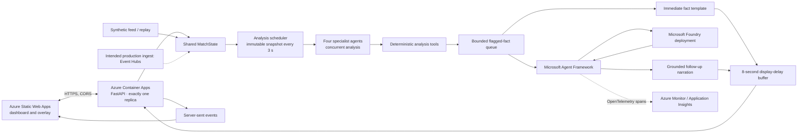

# Overseer

Live website: `<LIVE_URL>` (replace this placeholder with the deployed site URL).

Overseer is a multi-agent match-intelligence platform. Specialist agents analyse team shape, pressing, patterns of play, player influence and momentum from a live event feed, writing structured, traceable facts into a shared state. A grounded Narrator renders them as timecoded broadcast overlays and personalised, multilingual commentary for broadcast, analyst and fan modes, on Microsoft Foundry and Azure.

## Screenshots

Screenshot placeholder: add a match-desk image here after deployment.

## Architecture



The running feed and replay state are in-process. Event Hubs is the intended
production ingest, but is not part of this deployment phase. Cosmos DB and
Azure Web PubSub are also out of scope; the current overlay transport is
server-sent events (SSE). The Container App is pinned to exactly one replica
because match state and the delayed stream buffer are held in memory.

## What runs where

| Component | Location | Responsibility |
| --- | --- | --- |
| FastAPI backend | Azure Container Apps (one replica) | Match state, deterministic engine, Agent Framework calls, overlay JSON, delayed SSE |
| Dashboard and browser overlay | Azure Static Web Apps (Free) | Browser UI, configured to call the backend API |
| Language model | Microsoft Foundry | Grounded specialist-agent and narration responses |
| Telemetry | Azure Monitor / Application Insights | Export of OpenTelemetry agent spans when configured |

The backend uses a system-assigned managed identity with the Foundry User role
on the Foundry **project** scope. Local development uses
`DefaultAzureCredential` (for example, `az login`). The application does not
use API keys.

## Status

| Capability | Status | Notes |
| --- | --- | --- |
| Deterministic analysis | Working | Existing engine functions remain deterministic and their tests are unchanged |
| Agent Framework and Foundry client | Working | Agent Framework agents use the Foundry chat client and `DefaultAzureCredential` |
| Concurrent analysis and narration | Working | Four analysts process immutable snapshots concurrently; only flagged facts reach the Narrator |
| Delayed stream and commentary history | Working | Stream output is delayed by eight match-seconds by default; commentary history is bounded to 500 items |
| All-player impact and gravity | Working | `/stats/players` and the Impact analyst include all 22 players, impact components, nearby-opponent pressure, convergence, and normalized gravity index |
| Match recaps | Working | Deterministic recap facts feed multilingual Broadcast/Analyst/Fan narration; halftime and full-time recaps are generated automatically during replay |
| Manager-style match desk | Working | Animated full-screen pitch, timed insight cards, commentary history, sortable statistics panels, and transparent broadcast overlay |
| In-memory feed and replay | Working | Synthetic replay is supported; runtime state is process-local |
| SSE overlays and dashboard latency | Working | Overlay JSON contains event-to-emission latency; dashboard displays it |
| Azure Monitor tracing | Working when configured | Set `APPLICATIONINSIGHTS_CONNECTION_STRING`; otherwise the app warns and continues |
| Container Apps replica count | Pinned to one by deployment script | State, replay, and delayed delivery are in process and are not replica-safe |
| Container Apps and Static Web Apps deployment | Scripted; deployment not verified here | Run `infra\deploy.bat` from cmd.exe against your Azure subscription |
| Event Hubs ingestion | Intended production design | Not provisioned or enabled by the deployment script |
| Cosmos DB persistence and Web PubSub | Out of scope | Not provisioned or required for the in-process feed |

## Requirements

- cmd.exe for the Windows deployment script
- Python 3.13 for local development (the deployment container uses Python 3.12)
- An Azure subscription and Azure CLI
- A Microsoft Foundry project and a deployed model
- Node.js/npm and the Static Web Apps CLI for deployment

## Configure a local Foundry connection

From the repository root in cmd.exe:

```bat
copy .env.example .env
notepad .env
```

Set `FOUNDRY_PROJECT_ENDPOINT` to the HTTPS Foundry project endpoint and
`FOUNDRY_MODEL` to the **deployment name**. The optional
`APPLICATIONINSIGHTS_CONNECTION_STRING` may be left blank to disable Azure
Monitor export. `.env` is ignored by Git; do not commit real configuration or
credentials.

Install dependencies, sign in, and run the API:

```bat
py -3.13 -m venv .venv
.venv\Scripts\python.exe -m pip install -r requirements.txt
az login
.venv\Scripts\python.exe -m uvicorn api.main:app --reload
```

Open `http://127.0.0.1:8000`, then choose **START REPLAY**. The app loads
`.env` through `python-dotenv`. A missing or unreachable Foundry deployment
does not stop deterministic processing; the Narrator uses its templated
fallback.

Run the Foundry smoke scripts and tests:

```bat
.venv\Scripts\python.exe scripts\test_agents.py
.venv\Scripts\python.exe scripts\test_narrator.py
.venv\Scripts\python.exe -m pytest -q
```

`test_agents.py` compares ShapeAnalyst output with `engine.patterns.block()`.
`test_narrator.py` requests Broadcast/English, Analyst/Spanish, and Fan/Arabic.
Both smoke scripts allow a longer response window than the live-path timeout.

## Build and run the container locally

With Docker installed:

```bat
docker build -t overseer-api .
docker run --rm -p 8000:8000 --env-file .env overseer-api
```

The image starts `uvicorn api.main:app` on port 8000. The Docker build compresses
the bundled synthetic replay data and the backend reads it transparently.
`.dockerignore` excludes `.env` and virtual environments from the build context.

## Deploy to Azure from cmd.exe

Create a Foundry project and model deployment first. Obtain the full Azure
resource ID of that Foundry **project**; the deployment script does not create
Foundry resources or infer the project scope from the endpoint.

1. Edit the configuration values near the top of `infra\deploy.bat`:
   - `RESOURCE_GROUP_NAME`
   - `REGION`
   - `STATIC_WEB_APP_REGION`
   - `CONTAINER_APP_NAME`
   - `STATIC_WEB_APP_NAME`
   - `ACR_NAME`
   - `FOUNDRY_PROJECT_SCOPE`
2. Ensure the repository-root `.env` contains the Foundry endpoint and model
   deployment name. Application Insights is optional.
3. Open cmd.exe at the repository root, sign in, select your subscription, and
   install the Static Web Apps CLI:

```bat
az login
az account set --subscription "<subscription-id>"
npm install -g @azure/static-web-apps-cli
```

The batch file uses the local Docker CLI to build and push the backend image to
ACR, updates the Container App to exactly one replica, assigns its
system-managed identity, and grants it the Foundry User role on
`FOUNDRY_PROJECT_SCOPE` using role definition ID
`53ca6127-db72-4b80-b1b0-d745d6d5456d`. It creates a Free Static Web App,
stages `web/` with the backend URL in `config.js`, deploys the staged content
using the Static Web Apps CLI, and restricts backend CORS to the Static Web App
origin. The temporary staged copy is removed after deployment.

The script reads `FOUNDRY_PROJECT_ENDPOINT`, `FOUNDRY_MODEL`, and the optional
Application Insights connection string from the process environment first,
then `.env`. It does not print the Static Web Apps deployment token. The Azure
account needs permission to create the resources and assign roles; role
assignment may require an elevated Azure RBAC role such as Owner or User Access
Administrator.

Run either part independently after the initial setup, or run both:

```bat
cmd.exe /c infra\deploy.bat backend
cmd.exe /c infra\deploy.bat frontend
cmd.exe /c infra\deploy.bat
```

## How the agents collaborate

ShapeAnalyst, PatternSpotter, ImpactAnalyst, and MomentDetector use local,
typed engine-function tools through Agent Framework `Agent` instances backed
by `FoundryChatClient`. The Narrator receives structured facts only; it does not
read raw events. Narration instructions require it to use only supplied facts,
preserve player and club names, and follow the selected language and mode.

Every three match-seconds by default, the four analyst roles receive the same
detached, immutable match snapshot and run concurrently. Each task updates only
its assigned state section. Deterministic analysis runs alongside the agents;
unflagged events do not trigger model calls. Flagged facts enter a bounded
queue. Overseer emits a grounded template overlay first, then the Narrator
creates a follow-up without waiting for unrelated analysts. Both frames and
overlays are held by the eight-match-second display-delay buffer before clients
receive them over SSE.

Foundry calls are capped by `LLM_MAX_CONCURRENCY` (default `2`) and retry once
with backoff after HTTP 429. `ANALYSIS_TICK_SECONDS` controls the analyst
interval. `STREAM_DELAY_SECONDS` controls the display delay (default `8`);
frames, events, and overlays are held until the delayed display clock reaches
their match time. Overlay JSON carries both `start_tc` and `ingest_tc`, and
late analyst results are retained with `late: true`. The dashboard displays
the configured delay and average/maximum analyst latency. `GET /agents/status`
returns current task and latency data; `GET /commentary?limit=&since=` returns
the bounded, ordered commentary history. Narration caching is keyed by
language, mode, favourite team, and fact ID.

At application startup, Azure Monitor is configured once if
`APPLICATIONINSIGHTS_CONNECTION_STRING` is populated. Missing or invalid
configuration produces a warning and does not prevent the service from
starting. Agent spans are named `agent.<name>` and include `agent.name`,
`fact.ids`, and `agent.latency_ms`. Raw prompts and connection strings are not
recorded as span attributes.

## Player gravity and match recaps

`GET /stats/players` returns all 22 roster entries, including players with no
event contributions yet. Each entry includes an impact score and its
involvement, shots-created, defensive-actions, and momentum-while-on-ball
components. Gravity reports average nearby outfield opponents with and without
the ball, plus convergence (pull) values for both situations. Tracking
coordinates are normalized to the 0–100 pitch scale: nearby means within 10
coordinate units. The 0–100 gravity index normalizes each player's average
nearby-opponent count against the highest player value in that match.

`POST /recap/generate` accepts optional `mode`, `language`, and
`favourite_team` fields; omitted values use the current dashboard preferences.
The response contains the generated text, its deterministic fact bundle, and
fallback metadata. `GET /recap` returns the current recap, while
`GET /recap?recap_type=halftime` and `GET /recap?recap_type=full_time` retrieve
the automatic replay recaps (or generate one if that phase is not yet cached).
The deterministic bundle includes the score, team statistics, key moments and
explanations, top influencers and component scores, patterns, block changes,
and momentum swings. Only this bundle is sent to the Narrator. Replay triggers
the halftime recap on reaching minute 45 and the full-time recap on completion.

## Match desk interface

The browser UI is plain HTML, CSS, and JavaScript with no build step.
`web/config.js` continues to provide `OVERSEER_API_BASE_URL`; the dashboard
and transparent `/overlay.html` client use it for API requests and the SSE
stream. The match desk interpolates tracking frames on a canvas, with optional
shape, pass, and heat layers. Click a player to inspect their statistics; in
Fan mode the selected player is followed by narration.

Use the numbered panel shortcuts 1–8 to open match data, **H** for commentary
history, and **Esc** to close the active panel. Panels overlay rather than
resize the pitch. Arabic selection switches the interface direction to RTL.
The dashboard relies on `EventSource` reconnection and shows a reconnecting
state; the companion transparent overlay independently hydrates recent
payloads and retries if its initial API request is unavailable.

## Responsible AI and limitations

- Match records come exclusively from the synthetic generator and must not be
  presented as broadcast evidence.
- Narration is grounded in supplied facts and has a deterministic template
  fallback; generated narration can still be incomplete or misleading and
  should be reviewed before broadcast.
- Fact IDs and spans support traceability but do not constitute a guarantee of
  model correctness.
- Match state, recent overlays, and narration cache are in process and are not
  shared across replicas or persisted across restarts.
- Event Hubs is the intended production ingestion service. The current deployment retains
  the in-process feed; Event Hubs, Cosmos DB, and Web PubSub infrastructure
  are not provisioned here.
- Verify target-region availability, pricing, quota, managed-identity role
  assignment, CORS behavior, and Static Web Apps deployment permissions before
  production use.
